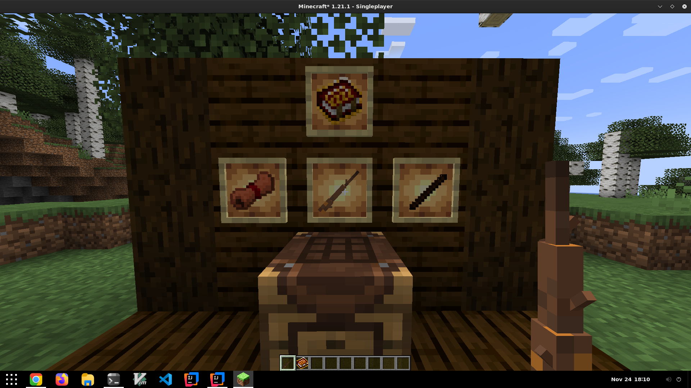
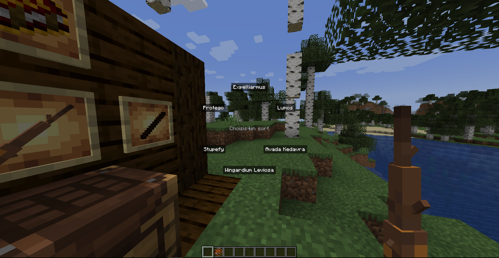
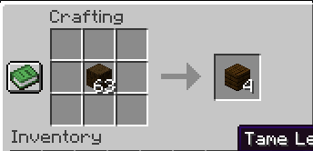
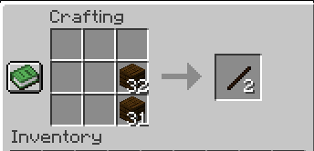
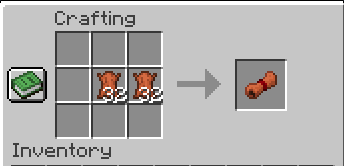
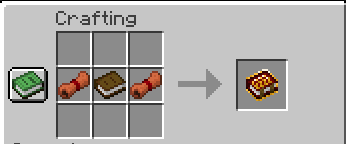
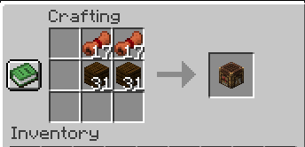

# 🪄 Fabulous Wands


**Fabulous Wands** is a Minecraft mod that adds **magic wands**, inspired by Harry Potter.
Craft wands with different **types** and **specialties**, cast **spells**, wear **wizard armor**, repair your gear at a magic workbench and trade with **wizards** hidden in the forests.

> ⚠️ **This mod is in pre-alpha.** Everything below is the design of the mod and most of it is not coded yet. See the [Roadmap](#-roadmap).

---

## 📋 Table of Contents

- [Features](#-features)
- [Wands](#-wands)
- [Spells & Controls](#-spells--controls)
- [Wizard Armor & Tools](#-wizard-armor--tools)
- [Blocks](#-blocks)
- [Items & Resources](#-items--resources)
- [Wizard NPC](#-wizard-npc)
- [Installation](#-installation)
- [Roadmap](#-roadmap)
- [Mod Info](#-mod-info)

---

## Gallery





\
*(1 Noble Log = **4 Noble Planks**)*


\
*(2 Noble Plank = **2 Noble Stick**)*


\
*(2 Leather = **1 Tame Leather**)*


\
*(2 Leather & 1 Book = **1 Guide Book**)*


\
*(2 Tame Leather & 2 Noble Plank = **1 Wandcraft Table**)*

---

## ✨ Features

- 🪄 **Wands** with 5 types, specialties (fire, water, air, lightning…) and their own spells
- 🔮 **Spell system** with cooldowns, quick switch and a spell selection menu
- 🛡️ **Wizard armor** in 3 tiers, with bonuses like extra health and temporary flight
- ⚔️ **Enchanted tools** (sword, axe, pickaxe) that can carry spells
- 🧰 **WandCraft Table** to craft wands and wizard gear
- 🔧 **Ollivander Workbench** to repair wands, armor and tools
- 🌲 **Noble tree**, a rare new tree found in dark and taiga forests
- ⚡ **Lightning powder**, collected when lightning strikes a lightning rod
- 🧙 **Wizard NPC** that trades wands, spells and potions

---

## 🪄 Wands

Every wand is defined by:

1. **Type** – its quality and rarity (1 to 5)
2. **Name** – a short name, e.g. *Magic Wand*
3. **Spells** – depending on its type and specialty
4. **Durability** – wands never break, they just **stop working** until repaired at the [Ollivander Workbench](#-ollivander-workbench)
5. **Craft** – each wand has its own unique recipe in the [WandCraft Table](#-wandcraft-table)

### Types, specialties & durability

The **specialty** of a wand is linked to its **type**, and comes from the [special item](#-special-items) used to craft it.
Type 1 is the worst and most common, type 5 is the best and rarest.

| Type | Title               | Specialty     | Rarity | Durability |
| :--: | ------------------- | ------------- | :----: | :--------: |
|  1   | Apprentice Wizard   | ⚡ Lightning   |   ★    |    300     |
|  2   | Novice Wizard       | 💧 Water      |   ★★   |    550     |
|  3   | Medium Wizard       | 🔥 Fire       |  ★★★   |    850     |
|  4   | Master Wizard       | *Coming soon* |  ★★★★  |    1250    |
|  5   | Grand Master Wizard | 🌪️ Air       | ★★★★★  |    1650    |

★ = common ★★★★★ = very rare

Wands can be **crafted** in the WandCraft Table or **bought** from the [Wizard NPC](#-wizard-npc).

---

## 🔮 Spells & Controls

- Each wand has **1 or 2 unique spells**, and shares its **other spells** with all the wands of the same type.
- Each spell belongs to a specialty: fire, lightning, water, air.
- Spells have a **5 second cooldown**, shown in the **bottom right corner** of the screen.

| Action | Control (wand in hand) |
|---|---|
| Cast the selected spell | **Right click** |
| Switch spell | **Sneak + Scroll** |
| Open the **Spell Cast menu** (see all your spells) | **R** |

---

## 🧥 Wizard Armor & Tools

Crafted in the **WandCraft Table**. Armor is **unbreakable**: it has a durability and is repaired at the **Ollivander Workbench**.
You must **wear the armor** to use the matching wands.

| Armor | Bonus | Unlocks wands | Durability |
|---|---|:---:|:---:|
| Apprentice Wizard | More spells | Type 1-2 | ~150 |
| Medium Wizard | + Extra health | Type 3-4 | ~450 |
| Master Wizard | + Flight & armor levels | Type 5 | ~650 |

Each armor tier also keeps the bonuses of the previous ones.

**Flight:** double press **Space** to fly. Flight is temporary, from **2m30 up to 15 min** as you level up the armor.

### Tools

The **sword, axe and pickaxe** can carry spells too (like *haste, rage, strength*…), depending on their type, just like armor and wands. They are repaired at the Ollivander Workbench.

---

## 🧱 Blocks

### 🧰 WandCraft Table

The main block of the mod. Once you have it, it works like a normal crafting table **and** lets you craft wands, wizard armor and tools.

Crafted in a **crafting table**:

```
L  L  L       L = Tame Leather
S  T  S       S = Noble Stick
N  N  N       T = Lightning Powder
              N = Noble Wood
```

### 🔧 Ollivander Workbench

Repairs all the **wands, armor and tools** of the mod, using **special items** (like Lightning Powder).

Crafted in the **WandCraft Table**:

```
L  T  L       L = Tame Leather
S  B  S       T = Lightning Powder
W  W  W       S = Noble Stick
              B = Iron Block
              W = Noble Wood
```

---

## 🌲 Items & Resources

### Noble Wood

A rare wood that drops from the **Noble Tree** (*as rare as finding diamonds in a cave*).

- **Biomes:** Dark Forest, Taiga, Old Growth Pine Taiga, Old Growth Spruce Taiga, Snowy Taiga
- The noble tree **can't be replanted**, and can only be cut with a **diamond axe** or better.

### Noble Plank

```
.  W        W = Noble Wood   →   4x Noble Plank
.  .
```

Can be used to craft stairs, slabs and fences, like vanilla planks.

### Noble Stick

```
.  N        N = Noble Plank   →   4x Noble Stick
.  N
```

### Tame Leather

```
.  .        L = Leather   →   1x Tame Leather
L  L
```

### ✨ Special Items

Special items give a wand its **specialty** and are used to repair gear.

| Special item | Specialty | How to get it |
|---|---|---|
| ⚡ **Lightning Powder** | Lightning | Place a **lightning rod** with a clear view of the sky during a **thunderstorm**. When lightning strikes it: 66% → 1 powder, 33% → 2 powders, 1% → nothing. Immune to fire and explosions. |
| *More coming soon…* | | |

---

## 🧙 Wizard NPC

Wizards live in **their own house** in the same biomes as the Noble Tree.
They trade **wands, spells and potions** for **special items**, **emeralds** and **coins**.

| You give | You get |
|---|---|
| 16x Noble Wood **or** 8x Emerald | 1x Coin |
| 1x Special Item + 16x Coin + 32x Emerald | 1x Wand |
| 1x Special Item + 8x Coin + 16x Emerald | 1x Spell |
| 8x Coin **or** 8x Emerald | 1x Potion |

> Coins can **only** be obtained by trading with a wizard.

---

## 📦 Installation

> No release is available yet.

When the first version is out:

1. Install [Fabric Loader](https://fabricmc.net/use/) for **Minecraft 1.21.1**
2. Download [Fabric API](https://modrinth.com/mod/fabric-api) and put it in your `mods` folder
3. Put the **Fabulous Wands** `.jar` in your `mods` folder
4. Launch Minecraft with the Fabric profile

### Build from source

Requires **Java 21**.

```bash
git clone git@github.com:Sinayel/Fabulous-Wands.git
cd Fabulous-Wands
./gradlew build
```

The mod `.jar` will be in `build/libs/`.

---

## 🧭 Roadmap

- [x] Design the mod (wands, items, blocks, crafts)
- [X] Make a roadmap before coding
- [X] Start coding
- [X] Noble Wood, Noble Plank, Noble Stick
- [X] First wand with shooting
- [X] 1 Spell
- [X] Add Craft, Plank, Stick
- [X] WandCraft Table, Tame Leather
- [X] Spell Wheel
- [X] Guide Book
- [ ] Ollivander Workbench
- [ ] Noble Tree and world generation
- [ ] More Spells
- [ ] Wizard NPC
- [ ] Upgrade shooting styles (without bullet drop or less)
- [ ] More content (armor, tools, specialties, special items…)


---

## 📌 Mod Info

| | |
|---|---|
| **Mod Name** | Fabulous Wands |
| **Mod ID** | `fabulous_wands` |
| **Version** | Pre-Alpha 1.0 |
| **Minecraft** | 1.21.1 |
| **Mod Loader** | Fabric |
| **Language** | Java 21 |

---

*Fabulous Wands is a fan project and is not affiliated with Mojang Studios, Microsoft or Warner Bros.*
